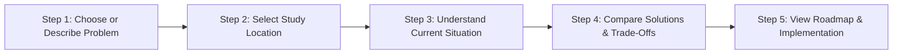

# WhatIf Decision-Simulation Command Center

> **An intuitive, engineering-grade digital twin and decision-simulation platform for urban infrastructure.**  
> Test policy, engineering, and operational interventions across road traffic, water distribution networks, and electric power grids before spending public capital.

[](https://nodejs.org/)
[](https://www.typescriptlang.org/)
[](https://react.dev/)
[](https://vitejs.dev/)
[](https://threejs.org/)
[](#12-testing-and-validation)
[](#17-license-and-credits)

---

## Table of Contents

1. [Project Introduction](#1-project-introduction)
2. [Main Features](#2-main-features)
3. [How WhatIf Works (Step-by-Step)](#3-how-whatif-works-step-by-step)
4. [Technology Stack](#4-technology-stack)
5. [Project Structure](#5-project-structure)
6. [Installation Requirements](#6-installation-requirements)
7. [Run Locally — Beginner Instructions](#7-run-locally--beginner-instructions)
8. [Environment Variables and Gemini Setup](#8-environment-variables-and-gemini-setup)
9. [Available npm Commands](#9-available-npm-commands)
10. [API Documentation](#10-api-documentation)
11. [Deploy on Vercel — Complete Beginner Guide](#11-deploy-on-vercel--complete-beginner-guide)
12. [Testing and Validation](#12-testing-and-validation)
13. [Data Sources and Engineering Limitations](#13-data-sources-and-engineering-limitations)
14. [Security & Safety Architecture](#14-security--safety-architecture)
15. [Troubleshooting Guide (10 Scenarios)](#15-troubleshooting-guide-10-scenarios)
16. [Future Improvements](#16-future-improvements)
17. [License and Credits](#17-license-and-credits)

---

## 1. Project Introduction

### The Problem
Modern municipal infrastructure decisions are fraught with risk. When a city experiences persistent traffic gridlock, recurring water-main pressure drops, or electrical distribution feeder overloads, decision-makers are faced with competing proposals from engineering consultants, vendors, and community stakeholders. Traditional infrastructure modeling tools (such as VISSIM, EPANET, and MATPOWER) are expensive, highly specialized, and siloed. Non-technical city administrators, budget officers, and the general public cannot interact with them directly, leading to costly trial-and-error public works projects and unintended secondary consequences.

### What is WhatIf?
**WhatIf** is an accessible, web-based Decision-Simulation Command Center designed for municipal leaders, civil engineers, urban planners, and curious citizens. It combines **deterministic domain physics solvers** with **interactive 2D/3D digital twins** and an **optional Google Gemini AI copilot** to make complex infrastructure dynamics understandable to anyone.

### Core Philosophy: Decision-Simulation
Unlike purely descriptive dashboards that only show past historical data, WhatIf is built around **forward-looking simulation**:
- **Simulate Before Spending:** Test hypothetical capital improvements (lane expansions, booster pumps, line re-conductoring) in software before pouring concrete or trenching streets.
- **Physics First, AI Second:** All numerical results (speeds, flow rates, hydraulic head, bus voltages, line overloads) are strictly computed by deterministic conservation equations, never hallucinated by large language models. The optional AI assistant only drafts scenario inputs, problem hypotheses, and stress tests.
- **Explain Trade-offs Honestly:** WhatIf highlights unintended secondary consequences (e.g., fixing one bottleneck may shift congestion to a downstream school zone; increasing pump pressure may stress aged pipe segments).
- **Zero Engineering Background Required:** Complex metrics are translated into plain-language human answers, intuitive visual change markers, and financial estimates formatted in Indian Rupees (₹ Crores and Lakhs).

---

## 2. Main Features

### 1. Three Essential Infrastructure Domains
- **🚗 Road Traffic Corridor:**
  - Macro-corridor flow and bottleneck analysis.
  - Interventions: Adaptive signal retiming, physical lane additions, reversible peak-hour lanes, dedicated transit lanes, corridor speed harmonization.
  - Outputs: Cell vehicle densities ($veh/km/lane$), space-mean travel speeds ($km/h$), travel time indices, and queue spillbacks.
- **💧 Water Distribution Network:**
  - Pressurized municipal water pipeline loops, reservoirs, and booster pumping stations.
  - Interventions: Main diameter enlargement, parallel relief loops, variable-speed booster pump additions, pressure reducing valve (PRV) installations, elevated storage tanks.
  - Outputs: Junction hydraulic pressure heads ($kPa$), nodal demands ($L/s$), pipe flow velocities ($m/s$), and friction head losses ($m$).
- **⚡ Electric Power Grid:**
  - High-voltage and medium-voltage transmission/distribution networks with generators, transformer substations, and regional load centers.
  - Interventions: Transmission line re-conductoring, step-up transformer upgrades, utility-scale battery energy storage systems (BESS), solar PV integration, generator active power redispatch.
  - Outputs: Bus voltage phase angles ($\theta$), real power branch flows ($MW$), line thermal loading percentages ($\%$), and $N-1$ contingency survival margins.

### 2. Rigorous Governing Physics Solvers
- **Traffic:** Daganzo's Cell Transmission Model (CTM) discretizing hydrodynamic LWR (Lighthill-Whitham-Richards) partial differential equations with triangular fundamental diagrams and Courant-Friedrichs-Lewy (CFL) numerical stability enforcement.
- **Water:** Nonlinear network hydraulic equilibrium solved via Hazen-Williams and Darcy-Weisbach head-loss formulations with Colebrook-White friction factor regimes across laminar, transition, and fully rough turbulent flows.
- **Energy:** Linearized DC Power Flow solving $P = B'\theta$ using sparse network nodal admittance/susceptance matrices and branch thermal rating checks.

### 3. Dual Digital Twin Visualizations
- **Interactive 2D Geographic Map:** High-performance vector canvas overlaying OpenStreetMap data with dynamic heatmaps, asset status badges, interactive feature picking, and layer toggles.
- **Photorealistic & Holographic 3D Digital Twin:** Built on Three.js featuring:
  - Procedural building extrusions derived from real OpenStreetMap polygon footprints.
  - Dual graphics profiles: **Photorealistic Daylight** (sunlight casting, atmospheric haze, urban asphalt textures) and **Cyber Holographic** (dark-mode emissive grid, pulsing sensor beacons, wireframe scans).
  - WebGL fallback mode and GPU hardware acceleration auto-detection.
  - Domain coverage auras: Glowing emerald green halos highlighting assets eligible for simulation.

### 4. Massive Before vs After Comparison & Change Navigator
- Dedicated comparison view displaying baseline versus proposed interventions side-by-side or as a split slider.
- **Massive visual change markers** featuring animated pulsing radar rings, color-coded delta badges, and direct camera auto-framing on modified assets.
- **10-Point Plain-Language Breakdown:** Explaining exactly what changed, why it changed, primary benefits, unintended side effects, and recommended safeguards.

### 5. 14 Connected Decision-Support Engines
- Multi-Criteria Decision Analysis (TOPSIS & Weighted Scoring).
- Financial Cost-Benefit Modeling in Indian Rupees (₹ Crores / Lakhs).
- Carbon Emission & Environmental Impact Accounting.
- Climate and Population Stress Sensitivity Testing (5, 10, and 20-year horizons).
- Future Regret Explorer minimizing worst-case municipal investment exposure.

### 6. Optional AI Scenario Planner (Google Gemini)
- Powered by `gemini-3.8-flash` via the Google Gemini Developer API.
- Converts plain-English infrastructure complaints (e.g., *"The intersection outside the regional hospital backs up every evening between 5 PM and 8 PM"*) into validated scenario parameters.
- Operates under strict server-side JSON schema boundaries; cannot hallucinate physical results.

---

## 3. How WhatIf Works (Step-by-Step)

The application guides the user through an intuitive **5-step workflow** (orchestrating the 8 core decision stages):



### Step 1: Select or Describe the Problem
- **Problem Catalog:** Choose from pre-configured municipal scenarios across Traffic, Water, and Energy.
- **Action-First Plain Input:** Type any real-world infrastructure problem in plain English. The built-in rule engine (or optional Gemini AI) converts your statement into candidate engineering parameters.

### Step 2: Choose Study Location
- Navigate the interactive 2D or 3D regional map.
- View **Emerald Green Simulation Auras** showing all physically modeled corridors, pipes, and electrical lines.
- Click any asset to inspect its engineering properties and click **"Use This Location"** to lock the study area.

### Step 3: Understand Current Situation (Baseline Physics)
- The deterministic physics solver immediately computes the baseline state without any intervention.
- The UI highlights active operational breaches in plain language:
  - *Traffic:* "Corridor operating at 18 km/h (severe congestion below 22 km/h municipal standard)."
  - *Water:* "Zone C junction pressure at 118 kPa (below 180 kPa fire protection minimum)."
  - *Energy:* "Feeder Line 4 operating at 104% of thermal capacity (critical overload)."

### Step 4: Compare Solutions & Trade-Offs
- Review multiple proposed engineering interventions (e.g., Alternative A vs Alternative B vs Alternative C).
- Use the **Dedicated Before vs After Map** with pulsing radar markers to inspect the spatial impact.
- Consult the **9 Human Questions Panel**:
  1. *What is the problem here?*
  2. *What if we try this solution?*
  3. *What will improve?*
  4. *What could go wrong?*
  5. *Which solution is best?*
  6. *How much will this cost?*
  7. *How long will construction take?*
  8. *What assumptions were made?*
  9. *What data is missing?*

### Step 5: Explore Future Conditions & Action Roadmap
- Subject both the baseline and candidate solutions to future stress tests (e.g., +25% population growth, peak summer heatwaves, main line burst).
- Review the generated **5-Phase Implementation Roadmap**:
  - *Phase 1:* Preliminary Feasibility & Geotechnical Surveys (Months 1–3).
  - *Phase 2:* Detailed Engineering Design & Statutory Clearances (Months 4–6).
  - *Phase 3:* Procurement & Tender Issuance (Months 7–9).
  - *Phase 4:* Construction, Installation & Phased Cutover (Months 10–18).
  - *Phase 5:* Operational Commissioning & Post-Occupancy Verification (Months 19–24).
- Export professional PDF/CSV executive reports or save scenarios directly to local browser storage.

---

## 4. Technology Stack

| Layer | Technology | Purpose & Rationale |
| :--- | :--- | :--- |
| **Frontend Framework** | React 19 (`react`, `react-dom`) | Latest React concurrent architecture, responsive component tree, zero tearing. |
| **Language** | TypeScript 5.8+ | Strict compile-time typing across all solvers, schemas, and UI state models. |
| **Build & Tooling** | Vite 8 + `@tailwindcss/vite` | Sub-second cold starts, modern ES module bundling, instant production builds. |
| **Styling** | Tailwind CSS 4 | Zero-runtime CSS design system with custom engineering palette and glassmorphism. |
| **3D Rendering** | Three.js (`v0.187.0`) | Hardware-accelerated WebGL rendering for 3D digital twin, procedural shaders, and skyboxes. |
| **Icons & Motion** | Lucide React + Motion (`v12`) | High-clarity vector UI iconography and fluid micro-animations. |
| **Local Backend** | Express 4 (`express`) | Lightweight local development server proxying Vite middlewares and secure API calls. |
| **Serverless Backend**| Node.js Serverless Functions | Clean export in `api/index.ts` natively executed on Vercel's edge network. |
| **AI Integration** | `@google/genai` (`v2.4.0`) | Official Google SDK calling `gemini-3.8-flash` with strict structured JSON schemas. |
| **Geographic Data** | OpenStreetMap (ODbL) | Real regional road networks, land cover, and building footprint polygons. |
| **Testing Engine** | Node.js Test Runner + `tsx` | Native TypeScript test execution with sub-second execution across 105 tests. |

---

## 5. Project Structure

```
whatif-decision-simulation-command-center/
├── api/
│   └── index.ts                 # Vercel serverless function entry point
├── docs/
│   ├── DOMAIN_MODELS.md         # Solver physics equations, parameters, and references
│   └── architecture.md          # Architectural blueprints and data contracts
├── public/
│   ├── favicon.svg              # WhatIf vector brand mark
│   └── maps/
│       └── region.json.gz       # Gzip-compressed ~80km x 80km OpenStreetMap regional dataset (includes Nambur/VVITU, Vijayawada, Guntur, and Tenali)
├── src/
│   ├── components/              # User interface components
│   │   ├── ChangeNavigatorBar.tsx      # Step-through controller for change markers
│   │   ├── ComparisonSummaryBar.tsx    # Compact delta summary metrics bar
│   │   ├── DashboardView.tsx           # Product landing page and domain selector
│   │   ├── DigitalTwinViewer2D.tsx     # High-performance 2D vector canvas viewer
│   │   ├── DigitalTwinViewer3D.tsx     # Three.js 3D photorealistic digital twin
│   │   ├── ExplainChangeModal.tsx      # 10-point change explanation modal
│   │   ├── GeographicMapView.tsx       # Dedicated GIS layer and bounds viewer
│   │   ├── GraphicsCompatibilityModal.tsx # GPU & WebGL fallback diagnostic dialog
│   │   ├── Navbar.tsx                  # Global navigation and domain switcher
│   │   ├── ResultsComparisonView.tsx   # Dual digital twin comparison layout
│   │   ├── Sidebar.tsx                 # Collapsible control and intervention panel
│   │   └── SimulationWorkspace.tsx     # 5-step guided decision simulation wizard
│   ├── models/                  # Solvers, decision engines, and data adapters
│   │   ├── actionParser.ts             # Plain-English rule-based intervention parser
│   │   ├── aiProblemAgent.ts           # Client-side agent bridge and fallback solver
│   │   ├── comparisonChangeNavigator.ts# Spatial delta and change-marker calculator
│   │   ├── decisionEngines.ts          # 14 decision-support engines (TOPSIS, NPV, etc.)
│   │   ├── defaultScenarios.ts         # Pre-configured baseline problem scenarios
│   │   ├── digitalTwinAdapters.ts      # Solver-to-geometry topological mapping
│   │   ├── digitalTwinShaders.ts       # Custom GLSL materials (Daylight & Hologram)
│   │   ├── domainEligibility.ts        # Spatial simulation coverage validation
│   │   ├── domainKnowledge.ts          # Physical parameter limits and engineering units
│   │   ├── geographicFeaturePicker.ts  # 2D/3D raycasting and feature picking
│   │   ├── regionalMap.ts              # OSM polygon parsing and 3D extrusion builder
│   │   └── waterSolver.ts              # Hazen-Williams and Darcy-Weisbach hydraulics
│   ├── server/
│   │   └── agentApp.ts          # Standalone Express app with rate limits & security
│   ├── tests/                   # 105 automated unit and integration tests
│   │   ├── actionParser.test.ts
│   │   ├── advancedBeforeAfter.test.ts
│   │   ├── currencyFormatter.test.ts
│   │   ├── digitalTwinAdapters.test.ts
│   │   ├── digitalTwinShaders.test.ts
│   │   ├── domainEligibility.test.ts
│   │   ├── regionalMap.test.ts
│   │   └── solvers.test.ts
│   ├── types/
│   │   └── index.ts             # Global TypeScript interface definitions
│   ├── App.tsx                  # Root application view router
│   ├── index.css                # Tailwind utility directives and custom animations
│   └── main.tsx                 # Client entry point mounting React root
├── .env.example                 # Documented template for environment variables
├── .gitignore                   # Git exclusion rules (ignores dist, .env*, .vercel)
├── package.json                 # Project dependencies, metadata, and npm scripts
├── server.ts                    # Local development and production preview server
├── tsconfig.json                # TypeScript compiler configuration
├── vercel.json                  # Vercel deployment and routing configuration
└── vite.config.ts               # Vite bundler plugins and path aliases
```

---

## 6. Installation Requirements

Before running WhatIf locally, ensure your workstation meets the following prerequisites:

1. **Node.js:**
   - **Recommended:** Node.js `22.12.0` (LTS) or higher.
   - **Minimum Supported:** Node.js `20.19.0`.
   - *Check your version:* `node -v`
2. **npm:**
   - Version `10.0.0` or higher (automatically installed with Node.js).
   - *Check your version:* `npm -v`
3. **Git:**
   - Modern Git client for cloning the repository.
   - *Check your version:* `git --version`
4. **Web Browser:**
   - Any modern browser with WebGL 2.0 support (Google Chrome 110+, Microsoft Edge 110+, Mozilla Firefox 115+, or Apple Safari 16.4+).
   - Dedicated or integrated graphics card (GPU) enabled with hardware acceleration.

---

## 7. Run Locally — Beginner Instructions

Follow these exact steps in PowerShell (Windows) or Terminal (macOS/Linux) to get WhatIf running on your machine:

### Step 1: Open PowerShell / Terminal
Open your terminal application and navigate to your preferred projects folder.

### Step 2: Clone the Repository
```powershell
git clone https://github.com/your-username/whatif-decision-simulation-command-center.git
cd whatif-decision-simulation-command-center
```

### Step 3: Install Project Dependencies
```powershell
npm install
```
*(This will download all required libraries into the `node_modules` folder in ~15–30 seconds).*

### Step 4: Configure Environment Variables (Optional)
If you wish to use the online Google Gemini AI scenario planner:
```powershell
Copy-Item .env.example .env.local
notepad .env.local
```
Inside `.env.local`, paste your free Gemini API key:
```env
GEMINI_API_KEY="AIzaSyYourActualKeyHere"
```
Save and close the file.

> [!NOTE]  
> **No API Key? No Problem!** WhatIf runs 100% locally and offline without an API key. All physics calculations, 2D/3D maps, scenario comparisons, and decision engines function completely without AI.

### Step 5: Start the Development Server
```powershell
npm run dev
```

### Step 6: Open the Application
Look at your terminal output for the local URL, then open your browser:
```
http://localhost:3000
```
You are now ready to explore and simulate urban infrastructure!

---

## 8. Environment Variables and Gemini Setup

WhatIf requires only **one optional environment variable**: `GEMINI_API_KEY`.

### Why is it Server-Side Only?
- In WhatIf, the Gemini API key is read **exclusively by the backend** (`src/server/agentApp.ts`).
- It is **NEVER** exposed to client browser code.
- **NEVER** rename this variable with a `VITE_` prefix (e.g., `VITE_GEMINI_API_KEY`). Any variable prefixed with `VITE_` is automatically baked into public JavaScript bundles by Vite, exposing your private key to any visitor.

### How to Get a Free Gemini API Key (60 Seconds)
1. Visit [Google AI Studio](https://aistudio.google.com/).
2. Sign in with any standard Google account.
3. Click **"Get API key"** in the top navigation.
4. Click **"Create API key"** (select a new or existing free-tier Google Cloud project).
5. Copy your generated key (`AIzaSy...`).
6. Paste the key into your local `.env.local` file or your Vercel project settings.

### Free-Tier Quota & Cost Protection
- WhatIf uses the `gemini-3.8-flash` model.
- If you leave billing unlinked on your Google Cloud project, Google enforces hard quota caps (e.g., 15 requests per minute, 1,500 requests per day) and **will never charge you money**.
- If quota is exceeded, the server returns an honest `HTTP 429` status explaining that free-tier capacity is temporarily full.

---

## 9. Available npm Commands

| Command | Action & Purpose | Typical Execution Time |
| :--- | :--- | :--- |
| `npm install` | Installs all package dependencies declared in `package.json`. | 15–30 seconds |
| `npm run dev` | Starts the full-stack development server with Vite HMR at `http://localhost:3000`. | < 1 second |
| `npm run build` | Compiles the React/TypeScript frontend into optimized static files in `dist/`. | ~750 ms |
| `npm start` | Launches the Node.js production server serving static assets and API routes. | < 1 second |
| `npm run preview` | Alias for `npm start` to test the compiled production bundle locally. | < 1 second |
| `npm test -- --run` | Executes all 105 automated unit and integration tests across 8 test suites. | ~1.4 seconds |
| `npm run lint` | Runs TypeScript type-checking across the entire codebase (`tsc --noEmit`). | ~1.2 seconds |
| `npm run check` | **Complete Quality Gate:** Runs type-check (`lint`) + `test` + production `build`. | ~4.5 seconds |
| `npm run clean` | Deletes the `dist/` folder and temporary build artifacts. | Instant |

---

## 10. API Documentation

The WhatIf backend exposes two clean, secure REST endpoints:

### 1. `GET /api/agent/status`
*Also responds on `/agent/status` for Vercel rewrite compatibility.*

Checks whether the server environment has configured an active Gemini API key.

- **Headers:** None required.
- **Success Response (`200 OK`):**
  ```json
  {
    "configured": true,
    "provider": "Google Gemini Developer API",
    "model": "gemini-3.8-flash",
    "mode": "Optional quota-limited Gemini key; billing status unknown; no paid tools enabled"
  }
  ```

---

### 2. `POST /api/agent/problem-draft`
*Also responds on `/agent/problem-draft` for Vercel rewrite compatibility.*

Drafts a structured engineering problem statement, physical parameter interventions, and future stress test cases from a natural-language brief.

- **Security Requirements:**
  - Must include `Content-Type: application/json`.
  - Must be a same-origin request (`Origin` header matches `Host` or `X-Forwarded-Host`).
  - Rate limited to 5 requests per minute per IP address.
  - Request body size strictly capped at 16 KB.
- **Request Body Schema:**
  ```json
  {
    "domain": "traffic",
    "studyArea": "Nambur - NH16 Corridor",
    "brief": "Heavy evening congestion near the central intersection between 5 PM and 8 PM.",
    "context": {
      "parameters": [
        {
          "targetId": "seg_nh16_core",
          "targetName": "NH16 Central Expressway",
          "property": "lanes",
          "label": "Number of Lanes",
          "unit": "lanes",
          "value": 3,
          "min": 1,
          "max": 6
        }
      ],
      "currentConstraints": [
        {
          "name": "Minimum Speed",
          "operator": ">=",
          "threshold": 22.0,
          "unit": "km/h"
        }
      ]
    }
  }
  ```
- **Success Response (`200 OK`):**
  ```json
  {
    "draft": {
      "title": "Evening Peak Bottleneck Relief",
      "description": "Evaluates lane capacity expansion and signal cycle rebalancing.",
      "measurableSymptom": "Space-mean corridor speed drops to 14.2 km/h during peak inflow.",
      "baselineChanges": [],
      "alternatives": [
        {
          "name": "Alternative A: Dynamic Peak Lane",
          "description": "Reallocates shoulder lane during peak hours.",
          "modifications": [
            {
              "targetId": "seg_nh16_core",
              "property": "lanes",
              "newValue": 4,
              "rationale": "Increases roadway throughput capacity."
            }
          ]
        }
      ],
      "futureCases": [
        {
          "name": "2030 Growth Shock",
          "horizonYears": 5,
          "multiplier": 1.25,
          "parameterShift": "inflowDemandVehHour",
          "description": "Simulates 25% regional traffic volume increase."
        }
      ],
      "assumptions": ["Assumes dry pavement conditions and standard driver compliance."],
      "missingData": ["Real-time origin-destination turn counts at intersection #4."]
    }
  }
  ```
- **Error Status Codes:**
  - `400 Bad Request`: Payload validation failed (invalid domain, out-of-range parameters, or text length violation).
  - `403 Forbidden`: Request blocked by same-origin security policy.
  - `415 Unsupported Media Type`: Payload is not JSON.
  - `429 Too Many Requests`: Rate limit exceeded (either client-side 5/min limit or Gemini API quota cap).
  - `502 Bad Gateway`: AI returned malformed output or upstream Google API connection failed.
  - `503 Service Unavailable`: Server has no `GEMINI_API_KEY` configured in environment variables.

---

## 11. Deploy on Vercel — Complete Beginner Guide

Deploying WhatIf to Vercel takes **under 3 minutes** using the official GitHub integration.

### Step 1: Push Your Code to GitHub
Open PowerShell in your project folder:
```powershell
# 1. Initialize git (if not already done)
git init

# 2. Stage and commit files
git add .
git commit -m "feat: complete WhatIf decision simulation platform"

# 3. Rename default branch to main
git branch -M main

# 4. Link your remote GitHub repository
git remote add origin https://github.com/your-username/whatif-decision-simulation-command-center.git

# 5. Push to GitHub
git push -u origin main
```

### Step 2: Import into Vercel
1. Log in to [vercel.com](https://vercel.com) (sign in with your GitHub account).
2. On your Vercel Dashboard, click **"Add New..."** → **"Project"**.
3. Select your GitHub repository (`whatif-decision-simulation-command-center`) and click **"Import"**.

### Step 3: Configure Project Settings
Vercel will automatically detect Vite and read `vercel.json`. Verify the settings:
- **Framework Preset:** `Vite`
- **Root Directory:** `./`
- **Build Command:** `npm run build`
- **Output Directory:** `dist`

### Step 4: Add Environment Variables
1. Expand the **"Environment Variables"** section.
2. Add your Gemini API key:
   - **Key:** `GEMINI_API_KEY`
   - **Value:** Paste your Google AI Studio key (`AIzaSy...`).
   - Check all environments: *Production*, *Preview*, and *Development*.
3. Click **"Deploy"**.

### Step 5: Verify Live Deployment
- Vercel builds the frontend and provisions the `api/index.ts` serverless function in ~45 seconds.
- You will receive a live production URL: `https://your-project.vercel.app`.
- Test the API status: Navigate to `https://your-project.vercel.app/api/agent/status`. It should return `{"configured": true, ...}`.

---

## 12. Testing and Validation

WhatIf includes a comprehensive automated test suite powered by the Node.js test runner and `tsx`.

### Running the Tests
To run all tests once:
```powershell
npm test -- --run
```
To run the full quality gate (lint + test + build):
```powershell
npm run check
```

### Complete Test Suite Breakdown (105 Tests Across 8 Suites)

| Suite Name | File | Tests | Key Behaviors Verified |
| :--- | :--- | :---: | :--- |
| **Action-First Structured Parser** | `actionParser.test.ts` | 7 | Sanitizes XSS/HTML, rejects off-topic queries, handles multi-part goals, enforces physical governing equations. |
| **AI Draft Solver Handoff** | `actionParser.test.ts` | 3 | Validates strict solver input whitelists, composes multi-step interventions, rejects out-of-range bounds. |
| **Digital Twin Before/After Framing** | `beforeAfterComparison.test.ts` | 6 | Calculates world camera zoom distances, verifies distinct Before/After states, audits 0 OSM traffic signals. |
| **Advanced Change Navigator** | `comparisonChangeNavigator.test.ts` | 6 | Evaluates modified/improved cells across 3 domains, verifies 10-point plain-language explanations. |
| **INR Currency Localization** | `currencyFormatter.test.ts` | 5 | Verifies USD to INR exchange conversion, formats Crores and Lakhs, validates technical vs simple modes. |
| **Digital Twin Adapters** | `digitalTwinAdapters.test.ts` | 5 | Detects traffic corridor bottlenecks, water pressure deficits, energy line overloads, and topological graphs. |
| **Digital Twin Shaders** | `digitalTwinShaders.test.ts` | 6 | Validates GLSL vertex/fragment shaders for Daylight and Holographic modes, skyboxes, and sensor beacons. |
| **Domain Eligibility & Coverage** | `domainEligibility.test.ts` | 8 | Validates spatial bounding boxes, detects domain mismatches, verifies plain-language coverage tips. |
| **Offline Problem Assistant** | `solvers.test.ts` | 5 | Verifies deterministic offline fallback responses, prevents hallucinated safety scores or numerical answers. |
| **Problem-Solving Journey** | `problemSolvingJourney.test.ts` | 12 | Tests the complete 5-step / 8-stage lifecycle from problem selection to baseline diagnostics and 5-phase roadmap. |
| **Regional OpenStreetMap Viewport** | `regionalMap.test.ts` | 15 | Validates building polygon extrusion, city core bounds (Nambur, Vijayawada, Guntur, Tenali), and landcover terrain. |
| **Solution Selection Recalculation** | `solutionInteractionRecalculation.test.ts` | 3 | Confirms instant deterministic recalculation when toggling between Baseline and Alternatives A, B, and C. |
| **Domain Solvers & Security Suite** | `solvers.test.ts` | 7 | Verifies CTM traffic conservation, Hazen-Williams/Darcy-Weisbach head loss, DC power flow, and CSV injection guards. |

**Current Test Results:**
```
ℹ tests 105
ℹ suites 8
ℹ pass 105
ℹ fail 0
ℹ cancelled 0
ℹ skipped 0
ℹ duration_ms ~1380ms
```

---

## 13. Data Sources and Engineering Limitations

### 1. OpenStreetMap Attribution
Geographic context data (city-core footprints, road centerlines, administrative boundaries, water bodies, and railways) is sourced from **OpenStreetMap** (ODbL license) © [OpenStreetMap contributors](https://www.openstreetmap.org/copyright).

### 2. Traffic Signal Data Honesty
- **The bundled OpenStreetMap dataset contains 0 mapped physical traffic signals** within the study corridor.
- Traffic signal timings simulated by WhatIf's Cell Transmission Model (CTM) are **simulated operational parameters** representing standard municipal cycle splits, not field-surveyed physical signal controllers.

### 3. Synthetic Network Topologies (Water & Energy)
- OpenStreetMap does **not** map underground municipal water distribution mains, pipe wall roughness coefficients, junction elevation heads, or booster pump performance curves.
- OpenStreetMap does **not** map electrical power line series reactances ($X_{pu}$), bus voltage phase angles, or substation transformer impedance ratings.
- Water distribution loops and electrical grid topologies used in WhatIf are **calibrated synthetic engineering models** designed to demonstrate realistic physical responses under stress.

### 4. Non-Certified Software Disclaimer
> [!IMPORTANT]  
> **WhatIf is a strategic planning and decision-simulation tool, not certified engineering design software.**  
> It does not replace licensed Professional Engineer (PE) stamped hydraulic models (EPANET), dynamic power stability software (PSS/E), or microscopic traffic simulations (VISSIM). All real-world public works projects require licensed engineering surveys, geotechnical reports, and statutory environmental impact assessments.

---

## 14. Security & Safety Architecture

WhatIf adheres to defense-in-depth principles:

1. **Strict Server-Side Secret Isolation:**
   - `GEMINI_API_KEY` is loaded only on the server.
   - It is never bundled into client assets or logged to stdout.
2. **Same-Origin Validation:**
   - Both `/api/agent/status` and `/api/agent/problem-draft` check the incoming `Origin` header against `Host` and `X-Forwarded-Host`. Cross-site API calls from external origins are rejected (`403 Forbidden`).
3. **Payload Sanitization & Strict JSON Bounds:**
   - Request bodies are limited to `16 KB`.
   - All input strings are sanitized against HTML tags, script injections, and non-printable control characters.
   - Scenario parameters are validated against an explicit whitelist of allowed engineering properties per domain.
4. **Rate Limiting & Cost Guardrails:**
   - Built-in sliding rate window restricts users to 5 AI draft requests per minute per IP address (`429 Too Many Requests`).
5. **Prompt Injection Hardening:**
   - User inputs are fed into the LLM as passive JSON data fields, accompanied by strict system instructions forbidding rule overrides or calculated claims.
6. **Data Injection Protection:**
   - Object parsers are hardened against `__proto__` and `constructor` prototype pollution.
   - CSV and PDF export generators neutralize spreadsheet formula injection characters (`=`, `+`, `-`, `@`).

---

## 15. Troubleshooting Guide (10 Scenarios)

### Scenario 1: Node.js Version Error
- **Symptom:** Terminal displays `SyntaxError: Unexpected token` or unsupported module errors when running `npm run dev`.
- **Fix:** WhatIf requires Node.js `20.19.0+` or `22.12.0+`. Run `node -v`. If your version is older, download the latest LTS release from [nodejs.org](https://nodejs.org/).

### Scenario 2: Port 3000 Already in Use
- **Symptom:** Terminal output: `Error: listen EADDRINUSE: address already in use 0.0.0.0:3000`.
- **Fix:** Specify a different port using environment variables:
  ```powershell
  $env:PORT="3001"; npm run dev
  ```
  Or kill the existing process occupying port 3000:
  ```powershell
  Get-Process -Id (Get-NetTCPConnection -LocalPort 3000).OwningProcess | Stop-Process -Force
  ```

### Scenario 3: "AI is not set up yet" in Application
- **Symptom:** Problem assistant shows a warning banner: *"AI is not set up yet. Add your free-tier Gemini key to the server environment..."*
- **Fix:** Create a `.env.local` file in the project root containing `GEMINI_API_KEY="your_key"`, then restart the dev server (`Ctrl+C` followed by `npm run dev`).

### Scenario 4: HTTP 429 "Free-Tier Assistant Limit Reached"
- **Symptom:** AI draft requests fail with HTTP status 429.
- **Fix:** You have reached either WhatIf's per-minute rate limit (5 requests/min) or Google AI Studio's free-tier rate limit. Wait 60 seconds and try again. All non-AI simulation features remain fully functional.

### Scenario 5: 3D Digital Twin Shows Black Screen or WebGL Error
- **Symptom:** The 3D viewer fails to initialize or displays *"Hardware acceleration is disabled"*.
- **Fix:**
  1. Open your browser settings and enable **"Use graphics acceleration when available"**.
  2. In Chrome/Edge, navigate to `chrome://gpu` to verify WebGL 2.0 status.
  3. Click **"Switch to 2D Map"** in WhatIf's top HUD toolbar to use the zero-GPU vector canvas.

### Scenario 6: `npm run build` Fails
- **Symptom:** Build terminates with TypeScript or Vite bundling errors.
- **Fix:** Run `npm run lint` to inspect specific type violations. Clear corrupted build caches with `npm run clean`, delete `node_modules`, and reinstall:
  ```powershell
  npm run clean
  Remove-Item -Recurse -Force node_modules
  npm install
  npm run build
  ```

### Scenario 7: Git Merge Conflicts or Modified File Tracking
- **Symptom:** Git blocks branch changes due to local unstaged modifications.
- **Fix:** Inspect changed files with `git status`. Discard accidental modifications using `git restore <file>` or stash your work with `git stash`.

### Scenario 8: Tests Fail on Local Machine
- **Symptom:** `npm test` reports failed assertions.
- **Fix:** Verify you are running on Node.js 20.19+ or 22.12+. Ensure no global mock libraries are intercepting Node's built-in `node:test` runner. Run `npm test -- --run` to bypass file watchers.

### Scenario 9: `npm install` Fails with ERESOLVE Dependency Conflicts
- **Symptom:** npm refuses to install dependencies due to React 19 peer dependency warnings.
- **Fix:** Run the install with legacy peer flag:
  ```powershell
  npm install --legacy-peer-deps
  ```

### Scenario 10: Vercel Deployment Shows 404 on Page Refresh or API Calls
- **Symptom:** Navigating to sub-pages or making API requests on Vercel returns HTTP 404.
- **Fix:** Ensure `vercel.json` exists in the repository root and contains the correct rewrites for `/api/(.*)` → `/api` and `/(.*)` → `/index.html`. Verify that `api/index.ts` is present and exports the Express app.

---

## 16. Future Improvements

Planned future capabilities for WhatIf include:

1. **Multi-Agent Autonomous Infrastructure Coordination:** Autonomous agents representing competing utility operators negotiating resource allocations in real time.
2. **Live IoT & SCADA Telemetry Ingestion:** Direct streaming connectors for MQTT and REST protocols linking municipal sensor feeds to the digital twin.
3. **Native Engineering Format Import:** Direct drag-and-drop support for EPANET (`.inp`) water networks and MATPOWER (`.m`) / IEEE common data formats.
4. **Custom GIS Shapefile & LiDAR Ingestion:** User upload of custom GeoJSON, ESRI Shapefiles, and GeoTIFF elevation rasters for any city worldwide.
5. **Distributed Cloud Solver Cluster:** Offloading compute-heavy microscopic traffic models and Monte Carlo probabilistic power grids to distributed serverless clusters.

---

## 17. License and Credits

### License
**No license has been specified for this project yet.** There is currently no `LICENSE` file included in this repository. All rights are reserved by the original project contributors. Until a license is formally added, no permissions are granted to copy, distribute, modify, or commercialize this software.

### Credits & Acknowledgments
- **Google DeepMind:** For the Google Gemini Developer API and `gemini-3.8-flash` foundational intelligence.
- **OpenStreetMap Contributors:** For open-access global geospatial mapping under the ODbL license.
- **Three.js Team:** For the industry-standard WebGL 3D rendering library.
- **React & Vite Teams:** For high-performance frontend application architecture.
- **Civil & Power Engineering Community:** For public research papers on the Cell Transmission Model (Daganzo, 1994), Hazen-Williams hydraulic models, and DC Power Flow formulations.

---

*WhatIf Decision-Simulation Command Center — Designed for Clearer Decisions and Resilient Cities.*
